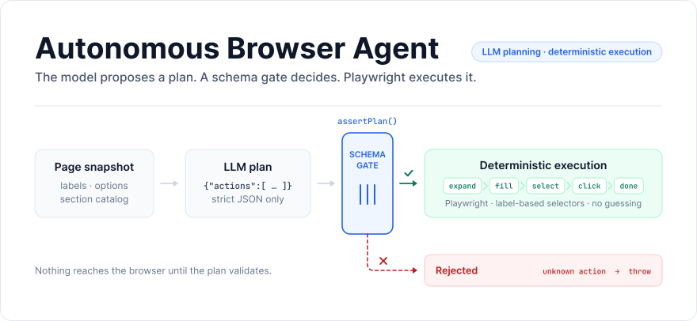
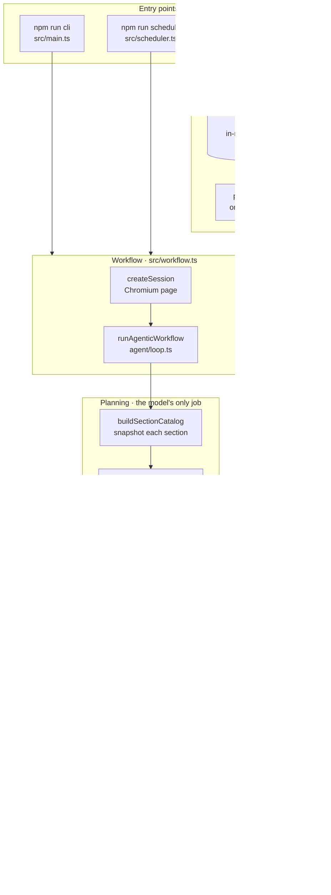
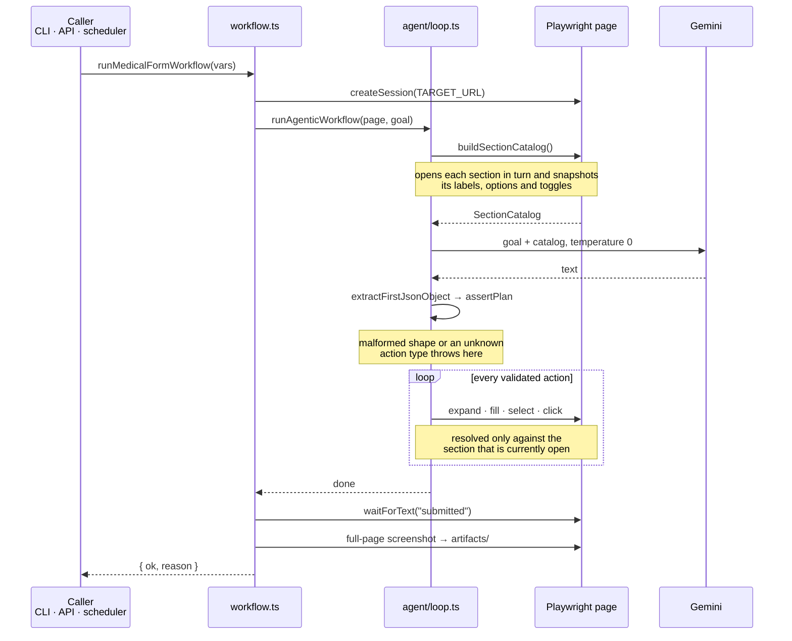

<div align="center">

<picture>
  <source media="(prefers-color-scheme: dark)" srcset="docs/hero-dark.svg" />
  
</picture>

**An LLM plans the form fill. A schema decides whether it runs. Playwright does the rest.**
An autonomous agent that discovers a multi-section web form, asks a model for a strictly<br />
validated JSON plan, and executes that plan deterministically — with no freeform browsing.

[](#testing)
[](#architecture)
[](#configuration)
[](LICENSE)

[](https://www.typescriptlang.org)
[](https://nodejs.org)
[](https://playwright.dev)
[](https://ai.google.dev)
[](https://vitest.dev)

[How it works](#how-it-works) · [Architecture](#architecture) · [HTTP API](#http-api) · [Getting started](#getting-started) · [Testing](#testing)

</div>

<br />

## Table of contents

- [About](#about)
- [How it works](#how-it-works)
- [Architecture](#architecture)
- [Interfaces](#interfaces)
- [Configuration](#configuration)
- [Project structure](#project-structure)
- [Getting started](#getting-started)
- [Testing](#testing)
- [Limitations](#limitations)
- [What's next](#whats-next)
- [License](#license)

## About

This project automates a multi-section healthcare form at
[magical-medical-form.netlify.app](https://magical-medical-form.netlify.app/). It discovers the page
structure at runtime, builds a catalog of the controls it finds, asks a language model for a
strictly validated JSON execution plan, and executes that plan deterministically with Playwright.

The point is not that a model can drive a browser. The point is the boundary around it. The model
is given one job — propose an ordered plan from a catalog of labels it did not invent — and
everything after that is ordinary, testable TypeScript. A plan that does not match the schema never
reaches the browser. A label the catalog does not contain cannot be filled. Model calls are capped.
The result is an agent that behaves predictably, avoids uncontrolled agent behavior, and keeps
clear execution boundaries.

It is a production-style execution loop, combining:

| Capability                | What it means here                                                            |
| ------------------------- | ----------------------------------------------------------------------------- |
| Structured LLM planning   | One prompt, a catalog of real controls, a JSON-only output contract           |
| Strict plan validation    | `assertPlan` checks every action's shape and type before anything runs        |
| Deterministic automation  | Label-driven selector resolution, hardened Playwright primitives, no guessing |
| Bounded model calls       | `MAX_MODEL_CALLS` caps the loop; `MIN_MODEL_DELAY_MS` paces it                |
| Single-worker queue       | One browser run at a time, so runs cannot race each other                     |
| HTTP API                  | Start a run, poll it, or wait for it synchronously                            |
| Interval-based scheduling | Repeat runs on a timer, with overlap prevention                               |
| Bounded run lifecycle     | In-memory registry with TTL pruning and a hard run-count ceiling              |
| Structured logging        | One JSON object per line, plus full-page screenshots into `artifacts/`        |

## How it works

1. **Snapshot the page.** `snapshotPage` walks the live DOM and collects every enabled input,
   button, select (with its options) and toggle, together with a label and a selector hint for each.
2. **Build a section catalog.** The form is an accordion — only one section is open at a time — so
   `buildSectionCatalog` opens *Personal Information*, *Medical Information* and *Emergency Contact*
   in turn, snapshots each, and returns one catalog of what actually exists per section.
3. **Ask for a plan.** The catalog and the goal go to Gemini at `temperature: 0`, with a strict
   output contract: JSON only, targets must match the supplied labels exactly, a maximum of 15
   actions, and a complete plan in a single response.
4. **Validate it.** `extractFirstJsonObject` pulls the first JSON object out of the reply and
   `assertPlan` type-checks every action. Anything malformed, or any action type outside the five
   supported ones, throws before a single click happens.
5. **Execute deterministically.** Each action is resolved against the catalog for the section that
   is currently open and run through hardened primitives that scroll into view first. A label the
   open section does not contain is an error, not a guess.
6. **Capture the result.** The workflow waits for the success text, writes a full-page screenshot to
   `artifacts/`, and emits structured logs throughout.
7. **Record the run.** Over the API, the run's state is tracked in a bounded in-memory registry and
   returned by polling or by waiting synchronously.

Core design principles: deterministic execution with no freeform browsing · label-driven element
resolution · a strict JSON-only LLM output contract · bounded model calls · a single browser worker
to avoid race conditions · memory-bounded run storage.

## Architecture

> [!IMPORTANT]
> **The schema gate is the whole thesis.** The model proposes; it never executes. Its only output is
> text, which must survive `extractFirstJsonObject` and then `assertPlan` before anything touches
> the page. Validation does not stop at shape, either: `expand` must name a known section toggle,
> `fill` and `select` must resolve to a label present in the section that is currently open, and
> `click` accepts only `Submit`. Everything else throws and writes a failure screenshot. That is why
> a model that hallucinates a field cannot invent one in the browser.

### System



### A run, end to end



### A real run

Actual output from `npm run cli`, verbatim apart from one shortened absolute path. A single model
call produced the whole fifteen-action plan, and the run finished in under four seconds.

```console
$ npm run cli

> autonomous-browser-agent@1.0.0 cli
> ts-node ./src/_internal/run.ts

{"ts":"2026-10-10T06:31:58.484Z","level":"info","msg":"workflow_start","data":{"url":"https://magical-medical-form.netlify.app/"}}
{"ts":"2026-10-10T06:31:58.806Z","level":"info","msg":"llm_call","data":{"modelCalls":1,"maxModelCalls":3}}
{"ts":"2026-10-10T06:32:01.422Z","level":"info","msg":"llm_raw_len","data":{"chars":892}}
{"ts":"2026-10-10T06:32:01.422Z","level":"info","msg":"plan_received","data":{"actions":["expand","fill","fill","fill","fill","expand","select","select","fill","fill","expand","fill","fill","click","done"],"done":true,"reason":"Form submitted successfully."}}
{"ts":"2026-10-10T06:32:01.422Z","level":"info","msg":"expand_skip_already_current","data":{"target":"Personal Information"}}
{"ts":"2026-10-10T06:32:01.455Z","level":"info","msg":"filled","data":{"selector":"#firstName","valuePreview":"John"}}
{"ts":"2026-10-10T06:32:01.500Z","level":"info","msg":"filled","data":{"selector":"#lastName","valuePreview":"Doe"}}
{"ts":"2026-10-10T06:32:01.552Z","level":"info","msg":"filled","data":{"selector":"#dateOfBirth","valuePreview":"1990-01-01"}}
{"ts":"2026-10-10T06:32:01.600Z","level":"info","msg":"filled","data":{"selector":"#medicalId","valuePreview":"91927885"}}
{"ts":"2026-10-10T06:32:01.684Z","level":"info","msg":"clicked","data":{"selector":"button:has-text(\"Medical Information\")"}}
{"ts":"2026-10-10T06:32:01.684Z","level":"info","msg":"expanded","data":{"target":"Medical Information","selector":"button:has-text(\"Medical Information\")"}}
{"ts":"2026-10-10T06:32:01.732Z","level":"info","msg":"selected","data":{"selector":"#gender","valueOrLabel":"Male"}}
{"ts":"2026-10-10T06:32:01.781Z","level":"info","msg":"selected","data":{"selector":"#bloodType","valueOrLabel":"O+"}}
{"ts":"2026-10-10T06:32:01.834Z","level":"info","msg":"filled","data":{"selector":"#allergies","valuePreview":"Peanuts"}}
{"ts":"2026-10-10T06:32:01.883Z","level":"info","msg":"filled","data":{"selector":"#medications","valuePreview":"Ibuprofen"}}
{"ts":"2026-10-10T06:32:01.965Z","level":"info","msg":"clicked","data":{"selector":"button:has-text(\"Emergency Contact\")"}}
{"ts":"2026-10-10T06:32:01.965Z","level":"info","msg":"expanded","data":{"target":"Emergency Contact","selector":"button:has-text(\"Emergency Contact\")"}}
{"ts":"2026-10-10T06:32:02.001Z","level":"info","msg":"filled","data":{"selector":"#emergencyContact","valuePreview":"Jane Doe"}}
{"ts":"2026-10-10T06:32:02.048Z","level":"info","msg":"filled","data":{"selector":"#emergencyPhone","valuePreview":"5551234567"}}
{"ts":"2026-10-10T06:32:02.116Z","level":"info","msg":"clicked","data":{"selector":"button:has-text(\"Submit\")"}}
{"ts":"2026-10-10T06:32:02.116Z","level":"info","msg":"done","data":{"reason":"Form submitted successfully."}}
{"ts":"2026-10-10T06:32:02.146Z","level":"info","msg":"wait_for_text_ok","data":{"text":"submitted"}}
{"ts":"2026-10-10T06:32:02.146Z","level":"info","msg":"success_toast_found","data":{}}
{"ts":"2026-10-10T06:32:02.190Z","level":"info","msg":"screenshot_saved","data":{"file":".../artifacts/1791613922147-final.png"}}
{"ts":"2026-10-10T06:32:02.190Z","level":"info","msg":"workflow_complete","data":{}}
```

Two details in that trace are worth pointing out. `expand_skip_already_current` is the executor
declining a redundant instruction from the model — it tracks which section is open itself, rather
than trusting the plan. And every selector in the log (`#firstName`, `#bloodType`,
`button:has-text("Submit")`) was resolved from a label in the catalog, never produced by the model.

## Interfaces

The same workflow is reachable three ways. All three run the identical agent loop.

### CLI

```bash
npm run cli
```

Runs the workflow once with the default variables and exits. Entry point: `src/main.ts`.

### HTTP API

```bash
npm run api
```

Three routes, served from `API_BASE` (default `/api/v1`):

| Method | Route       | Returns                                                     |
| ------ | ----------- | ----------------------------------------------------------- |
| `GET`  | `/health`   | `200 {"ok":true}`                                           |
| `POST` | `/run`      | `202` with a `runId`, or the finished run when `?wait=true` |
| `GET`  | `/runs/:id` | `200` with the run record, or `404` when the id is unknown  |

**Start a run and poll it.** `POST /run` enqueues and returns immediately:

```console
$ curl -s -i -X POST "http://localhost:3000/api/v1/run" \
    -H "Content-Type: application/json" \
    -d '{"vars":{"firstName":"Alice","lastName":"Ng"}}'

HTTP/1.1 202 Accepted
content-type: application/json

{"ok":true,"runId":"fdd81372-3ddd-4eb9-80d2-e3adc8bee4be"}

$ curl -s "http://localhost:3000/api/v1/runs/fdd81372-3ddd-4eb9-80d2-e3adc8bee4be"
{"ok":true,"run":{"id":"fdd81372-…","status":"running","createdAt":"2026-10-10T06:32:55.860Z","startedAt":"2026-10-10T06:32:55.861Z"}}

$ curl -s "http://localhost:3000/api/v1/runs/fdd81372-3ddd-4eb9-80d2-e3adc8bee4be"
{"ok":true,"run":{"id":"fdd81372-…","status":"succeeded","createdAt":"2026-10-10T06:32:55.860Z","startedAt":"2026-10-10T06:32:55.861Z","endedAt":"2026-10-10T06:33:01.144Z","result":{"ok":true,"reason":"Submitted"}}}
```

**Or wait for it synchronously.** Add `wait=true` and the response is held until the run finishes
(`200` on success, `500` otherwise), with `timeoutMs` bounding the wait — it defaults to `60000`:

```console
$ curl -s -X POST "http://localhost:3000/api/v1/run?wait=true&timeoutMs=60000" \
    -H "Content-Type: application/json" \
    -d '{"vars":{"firstName":"Alice","lastName":"Ng"}}'

{"ok":true,"run":{"id":"022ff842-…","status":"succeeded","createdAt":"2026-10-10T06:33:10.042Z","startedAt":"2026-10-10T06:33:10.042Z","endedAt":"2026-10-10T06:33:16.223Z","result":{"ok":true,"reason":"Submitted"}}}
```

Every field is validated before a run is queued, and a bad value is rejected with `400`:

```console
$ curl -s -X POST "http://localhost:3000/api/v1/run" \
    -H "Content-Type: application/json" -d '{"vars":{"firstName":123}}'

{"ok":false,"error":"Invalid field \"firstName\" (must be non-empty string)"}
```

#### Variable injection

Every form field can be overridden per run through `vars`. Anything left out falls back to the
default below.

| Variable                | Default      | Control  |
| ----------------------- | ------------ | -------- |
| `firstName`             | `John`       | input    |
| `lastName`              | `Doe`        | input    |
| `dateOfBirth`           | `1990-01-01` | input    |
| `medicalId`             | `91927885`   | input    |
| `gender`                | `Male`       | dropdown |
| `bloodType`             | `O+`         | dropdown |
| `allergies`             | `Peanuts`    | input    |
| `currentMedications`    | `Ibuprofen`  | input    |
| `emergencyContactName`  | `Jane Doe`   | input    |
| `emergencyContactPhone` | `5551234567` | input    |

#### Run lifecycle

A run moves through four states, and only one run executes at a time:

| State       | Meaning                                         |
| ----------- | ----------------------------------------------- |
| `queued`    | Accepted and waiting for the single worker      |
| `running`   | Holding the browser worker                      |
| `succeeded` | The workflow returned `{ ok: true }`            |
| `failed`    | The workflow threw; `error` carries the message |

Runs are held in an in-memory registry that prunes itself: finished runs are dropped once they are
older than `RUN_TTL_MS`, and the oldest runs are evicted beyond `MAX_RUNS`. Synchronous waiters are
cleaned up when their `timeoutMs` elapses, so a timed-out request leaves nothing behind.

### Scheduler

```bash
npm run schedule
```

Re-runs the workflow every `SCHEDULE_INTERVAL_MS`, optionally firing once on startup
(`SCHEDULE_RUN_ON_START`). If a run is still in flight when the timer fires, the tick is skipped and
logged as `schedule_skip_overlap` rather than starting a second browser. Intervals below `10000` ms
are rejected at startup.

## Configuration

Copy the example file and add your key — `.env.example` documents every option:

```bash
cp .env.example .env
```

| Variable                       | Default                                     | Purpose                                                         |
| ------------------------------ | ------------------------------------------- | --------------------------------------------------------------- |
| `GOOGLE_GENERATIVE_AI_API_KEY` | —                                           | Gemini API key. Required for planning                           |
| `TARGET_URL`                   | `https://magical-medical-form.netlify.app/` | The form to automate                                            |
| `HEADLESS`                     | `false` in `.env.example`                   | Run Chromium headless. Falls back to `true` if the var is unset |
| `GEMINI_MODEL`                 | `gemini-2.5-flash`                          | Planning model                                                  |
| `MAX_MODEL_CALLS`              | `3`                                         | Hard ceiling on model calls per run                             |
| `MIN_MODEL_DELAY_MS`           | `15000`                                     | Pause between model calls, to stay inside rate limits           |
| `PORT`                         | `3000`                                      | API server port                                                 |
| `API_BASE`                     | `/api/v1`                                   | Route prefix for every endpoint                                 |
| `SCHEDULE_INTERVAL_MS`         | `300000`                                    | Scheduler period. Must be at least `10000`                      |
| `SCHEDULE_RUN_ON_START`        | `true`                                      | Fire one run immediately when the scheduler starts              |
| `MAX_RUNS`                     | `200`                                       | Maximum run records kept in memory                              |
| `RUN_TTL_MS`                   | `3600000`                                   | How long a finished run is retained                             |

## Project structure

```
autonomous-browser-agent/
├── src/
│   ├── main.ts               Default CLI entry: runs the workflow once
│   ├── workflow.ts           Orchestration: session, goal, agent loop, screenshot
│   ├── session.ts            Chromium lifecycle
│   ├── logger.ts             One JSON object per line, to stdout
│   ├── scheduler.ts          Interval scheduler with overlap prevention
│   ├── agent/
│   │   ├── snapshot.ts       DOM snapshot: labels, options, toggles, selector hints
│   │   ├── catalog.ts        Opens each section and builds the section catalog
│   │   ├── loop.ts           Prompt construction, the model call, action dispatch
│   │   ├── json.ts           Strict JSON extraction from the model's reply
│   │   ├── types.ts          Plan and action types, and assertPlan
│   │   ├── resolve.ts        Label → selector resolution
│   │   └── tools.ts          Hardened Playwright primitives and screenshots
│   ├── api/
│   │   ├── server.ts         HTTP routes and the single-worker queue
│   │   └── registry.ts       Run registry: states, TTL pruning, waiters
│   └── _internal/
│       ├── run.ts            CLI bootstrap (loads .env)
│       └── setup.ts          Gemini model binding
├── __tests__/
│   ├── helpers/mocks.ts      Shared mock factories (page, catalog, snapshot)
│   ├── agent/                json · types · resolve · tools · loop
│   ├── api/                  registry pruning and waiters · API integration
│   ├── scheduler/            overlap prevention
│   └── workflow/             workflow helpers
├── docs/                     README hero artwork
├── artifacts/                Screenshots written at runtime (git-ignored)
└── .env.example              Every configuration option, documented
```

## Getting started

### Prerequisites

- [Node.js](https://nodejs.org/) 20 or newer
- A [Gemini API key](https://aistudio.google.com/apikey)
- Playwright-compatible system dependencies

### Quick start

```bash
git clone https://github.com/PrthD/autonomous-browser-agent.git
cd autonomous-browser-agent

npm install
npx playwright install
cp .env.example .env     # then add your Gemini API key

npm run cli              # one run, straight from the terminal
```

> [!NOTE]
> `npx playwright install` is a separate step from `npm install`. It downloads the browser binaries
> Playwright drives; without it the first run fails to launch Chromium.

> [!TIP]
> `.env.example` ships with `HEADLESS=false`, so your first run opens a real browser window —
> watching it expand each accordion section, fill the fields top to bottom and submit is the
> fastest way to understand the loop. Set `HEADLESS=true` on a server or in CI. If the variable is
> removed from `.env` altogether, the code default is headless.

### Commands

| Command                 | Description                                      |
| ----------------------- | ------------------------------------------------ |
| `npm run cli`           | Run the workflow once with the default variables |
| `npm run api`           | Start the HTTP API on `PORT`                     |
| `npm run schedule`      | Start the interval scheduler                     |
| `npm test`              | Run the full test suite                          |
| `npm run test:watch`    | Re-run tests on change                           |
| `npm run test:coverage` | Generate a coverage report into `coverage/`      |

## Testing

116 deterministic tests across 9 files, with [Vitest](https://vitest.dev):

```console
$ npm test

 ✓ __tests__/scheduler/scheduler.test.ts (8 tests) 10ms
 ✓ __tests__/agent/types.test.ts (27 tests) 12ms
 ✓ __tests__/api/registry.test.ts (13 tests) 19ms
 ✓ __tests__/agent/tools.test.ts (9 tests) 23ms
 ✓ __tests__/agent/loop.test.ts (14 tests) 52ms
 ✓ __tests__/agent/json.test.ts (11 tests) 11ms
 ✓ __tests__/agent/resolve.test.ts (19 tests) 7ms
 ✓ __tests__/api/server.test.ts (11 tests) 413ms
 ✓ __tests__/workflow/workflow.test.ts (4 tests) 6ms

 Test Files  9 passed (9)
      Tests  116 passed (116)
   Duration  910ms
```

Every test is fully mocked: no outbound network, no real browser launch, no LLM API calls. The
model is stubbed, the Playwright `Page` is a mock with the locator chain stubbed out, and the
filesystem is mocked where screenshots would be written. The API suite starts the real server on a
loopback port and exercises it over HTTP, with the workflow itself mocked.

`npm run test:watch` re-runs on change, and `npm run test:coverage` writes a v8 coverage report
into `coverage/`.

## Limitations

Known and deliberate, for a project of this scope:

- **In-memory run storage.** Run history does not survive a restart.
- **Single worker execution.** One browser run at a time, by design — it is what makes the runs
  predictable, and it is also the throughput ceiling.
- **No authentication layer.** The API is unauthenticated and assumes a trusted network.
- **Not horizontally scalable.** The queue and the registry live in one process.

## What's next

The natural path to production:

- A durable job queue (Redis / BullMQ) in place of the in-process queue
- Persistent run storage
- Browser pooling, to lift the single-worker ceiling
- Multi-tenant isolation
- Metrics and tracing
- Stronger submission verification

## License

Distributed under the MIT License. See [LICENSE](LICENSE) for details.
